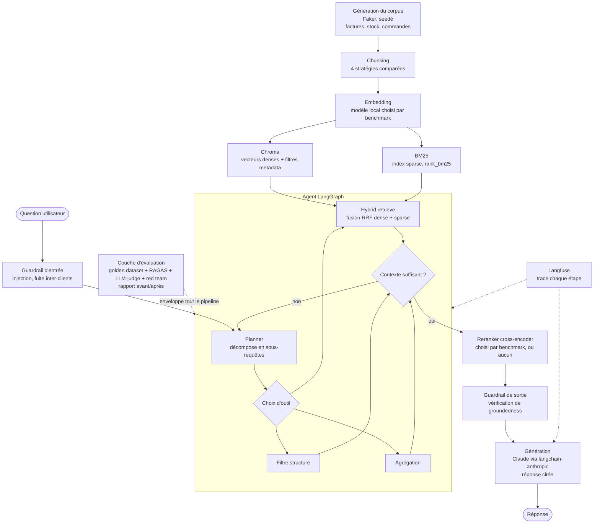

# Vue d'ensemble : architecture et pré-développement

> Résumé de `ARCHITECTURE.md` et `DevRoadmap.md` du repo de dev (`C:\Users\MSI\Downloads\assistant-rag-erp-simule`).
> Les fichiers originaux restent la source de vérité. Ce résumé est mis à jour quand ils changent.
> Dernière synchronisation : 2026-10-12.

---

## 1. Objectif en une phrase

Un **RAG agentique** sur un corpus ERP synthétique (factures, stock, commandes), dont **chaque choix technique est justifié par des chiffres** (benchmarks + évaluation avant/après). Sans chiffres, le projet n'est pas "fini".

Deux objectifs fusionnés :
1. **Pipeline RAG avancé** : chunking comparé, hybrid search, reranker cross-encoder, couche agentique
2. **Couche d'évaluation rigoureuse** : golden dataset, RAGAS + LLM-as-judge, observabilité, red teaming, guardrails, rapport chiffré

---

## 2. Schéma d'architecture


<details>
<summary>Version Mermaid (texte, plus facile à modifier)</summary>



</details>

**Lecture rapide :** la partie retrieval tourne **en local et gratuitement** (embeddings, Chroma, BM25). Seuls les appels LLM partent dans le cloud (génération et LLM-as-judge). La couche d'évaluation ne se branche pas à la fin : elle fait tourner **chaque variante** (chunking, retrieval, reranker, guardrails) sur le même golden dataset, pour obtenir un vrai tableau d'ablation.

---

## 3. Décisions de pré-développement

| Domaine | Décision | Pourquoi |
|---------|----------|----------|
| Modèle de déploiement | Hybride : retrieval local, génération cloud | Reproductible et gratuit côté retrieval, API payante seulement là où la qualité compte |
| Architecture avancée | **Agentic RAG** | Les questions ERP sont multi-entités et multi-hop, un seul passage retrieve-then-generate ne suffit pas |
| Orchestration | **LangGraph** | Machine à états explicite (plan, retrieve, check, re-plan). Composants LangChain utilisés seulement là où ils font gagner du temps |
| Langue | Anglais uniquement | Modèles d'embedding plus matures, audience portfolio plus large |
| Vector store | **Chroma** | Local, gratuit, persistant, avec filtrage metadata (indispensable pour les requêtes ERP). FAISS n'a pas de filtrage, Pinecone est payant et réseau |
| Index sparse | `rank_bm25`, fusion **RRF** | Pas de serveur, facile à garder synchronisé avec Chroma |
| Embedding | **Benchmarké**, pas présélectionné | Candidats : bge-small, bge-base, e5-small, all-MiniLM-L6 |
| Reranker | **Benchmarké**, avec baseline "sans reranker" | Candidats : ms-marco-MiniLM-L-6, L-12, bge-reranker-base |
| LLM de génération | **Claude** via `langchain-anthropic` | Derrière une abstraction, OpenAI interchangeable par config |
| LLM-as-judge | Claude, prompt et config séparés | Rubrique distincte du générateur, interchangeable si biais |
| Métriques auto | **RAGAS** | Faithfulness, answer relevancy, context precision, context recall |
| Observabilité | **Langfuse** (self-host docker-compose, ou cloud gratuit) | Intégration native LangGraph, versioning de prompts, gestion du golden dataset. Alternative : Arize Phoenix |
| Guardrails | **Custom**, pas de framework | Entrée : regex + petit classifieur (injection, fuite de données d'un autre client). Sortie : vérification de groundedness avec réponse "je ne sais pas" |
| Red teaming | Petit set adversarial + notation par LLM-judge | Injection, exfiltration inter-clients, questions hors corpus |
| Dépendances | **Poetry** | Déjà maîtrisé |

---

## 4. Stratégies de chunking à comparer

Les données ERP sont tabulaires, pas de la prose. La comparaison porte donc sur la structure :

| # | Stratégie | Idée | Attente |
|---|-----------|------|---------|
| 1 | Fixed-size (tokens) | Découpe brute, ignore la structure | Baseline à battre |
| 2 | **Record-level** | Une facture, une commande ou un article = un chunk, rendu via un template texte | Gagnant attendu |
| 3 | Hiérarchique | Chunk résumé + chunks de lignes, liés par ID | Pour les documents avec beaucoup de lignes |
| 4 | Sémantique | Découpe aux ruptures de similarité | Seulement pour les champs texte libres (notes, commentaires) |

---

## 5. Le principe "benchmarker puis décider"

Chunking, embedding et reranker sont **tous** choisis de la même façon :
1. Lister les candidats
2. Les faire tourner sur le même golden dataset, en gardant tout le reste fixe
3. Noter le résultat et la décision dans `eval/reports/<étape>_benchmark.md`

Ordre séquentiel : **chunking** (avec un embedding provisoire), puis **embedding**, puis **reranker**. Limite connue : c'est une ablation séquentielle, pas une grid search complète. À mentionner dans les rapports.

---

## 6. Structure du projet

```
assistant-rag-erp-simule/
├── data/            raw/ (corpus Faker), processed/ (chunks par stratégie)
├── src/erp_rag/
│   ├── corpus/        génération Faker
│   ├── ingestion/     chunking, loaders
│   ├── indexing/      embeddings, Chroma, BM25
│   ├── retrieval/     retriever hybride (RRF), reranker
│   ├── agent/         graphe LangGraph, nodes, tools
│   ├── generation/    abstraction du provider LLM
│   ├── guardrails/    input_guard.py, output_guard.py
│   └── observability/ tracing Langfuse
├── eval/
│   ├── golden_dataset/  qa_pairs.jsonl
│   ├── metrics/         ragas_eval.py, llm_judge.py
│   ├── redteam/         adversarial_prompts.jsonl
│   └── reports/         rapports de benchmark + rapport avant/après
├── notebooks/  tests/  scripts/ (build_corpus, build_index, run_eval)
```

---

## 7. Points ouverts (à trancher pendant le dev)

- Taille du golden dataset et taxonomie des requêtes (lookup / filter / aggregation / multi-hop). **À rédiger avant de construire l'agent.**
- BM25 reconstruit pour chaque stratégie de chunking, ou seulement pour la stratégie retenue ? À décider selon la taille du corpus.
- Langfuse self-host ou cloud gratuit ? Self-host par défaut, sauf si l'installation pose trop de problèmes.

---

## 8. Roadmap de développement (17 phases)

| Phase | Contenu | Tests ajoutés | Évolution du CI/CD |
|-------|---------|---------------|--------------------|
| 0 | Environnement, Git, **kata CI** | Aucun | **CI de base : lint ruff** |
| 1 | Corpus synthétique Faker | Unitaires (seed, schéma, références) | **+ pytest** |
| 2 | 4 stratégies de chunking | Unitaires | Inchangé |
| 3 | Golden dataset initial (15-25 questions) | Validation de données | + check du schéma du dataset |
| 4 | Indexing, hybrid retrieval, benchmark chunking | **Premier test d'intégration** | Suite de tests réelle |
| 5 | Benchmark embedding | Extension intégration | Inchangé |
| 6 | Benchmark reranker | Unitaires + intégration | Inchangé |
| 7 | Agent LangGraph | Intégration avec LLM mocké | Tests sans clé API |
| 8 | Génération + guardrails | Unitaires + intégration | **Premier secret** `ANTHROPIC_API_KEY`, jobs séparés |
| 9 | Golden dataset complet (75-150) + RAGAS + LLM-judge | Smoke test du harnais d'éval | Prépare l'eval gate |
| 10 | Red teaming | Le set adversarial lui-même | Alimente l'eval gate |
| 11 | Observabilité Langfuse | Résilience si Langfuse est indisponible | Variables Langfuse dans `.env.example` |
| 12 | **CI eval-gated** | Aucun nouveau | **PR bloquée si les scores RAGAS baissent** |
| 13 | Optimisation latence et coût | Benchmark de latence | Seuil de latence (optionnel) |
| 14 | Démo locale Docker + Streamlit | Smoke test du conteneur | Build Docker en CI (optionnel) |
| 15 | Déploiement web (HF Spaces, Render ou Fly.io, à décider) | Smoke test post-déploiement | **CD : déploiement auto après les gates** |
| 16 | Documentation et portfolio | Aucun | Aucun |

**Le fil rouge du CI/CD :** lint (Phase 0), puis tests unitaires (1), intégration (4), eval gate (12), et enfin déploiement automatique (15). Le fichier `ci.yml` grandit avec le projet.
