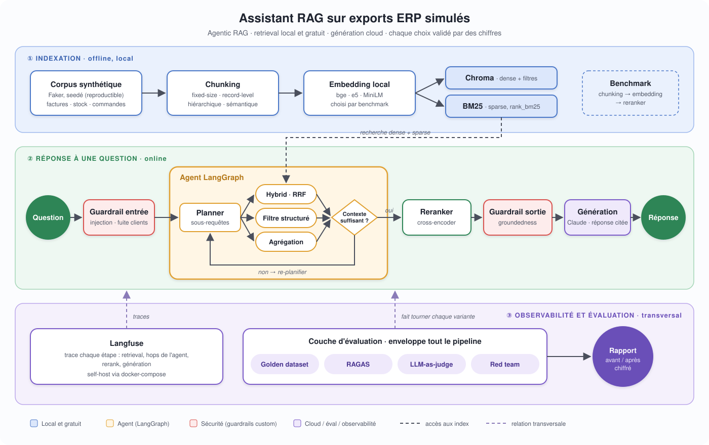
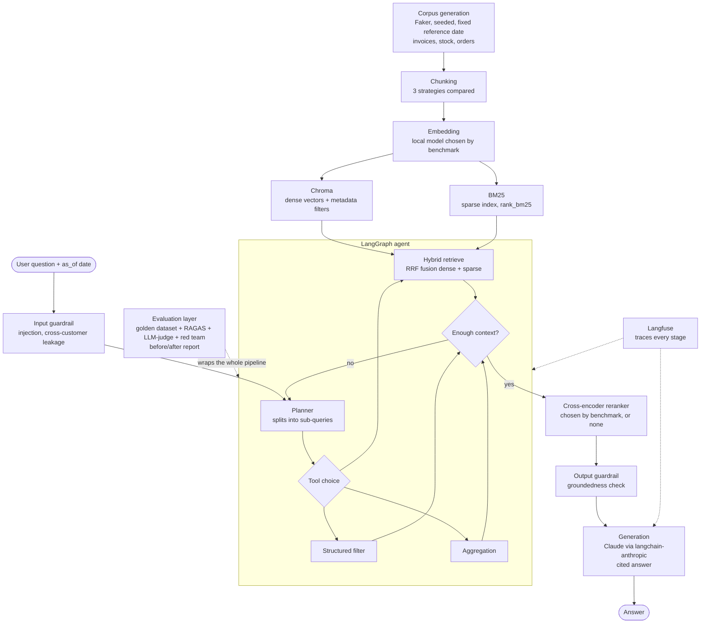

# Overview: architecture and progress

> Summary of `ARCHITECTURE.md` and `DevRoadmap.md`.
> The original files remain the source of truth. This summary is updated when they change.
> Last synced: 2026-10-30. **Progress:** Phases 0-3 done, Phase 4 (indexing, hybrid retrieval, chunking benchmark) next.

---

## 1. Goal in one sentence

An **agentic RAG** over a synthetic ERP corpus (invoices, stock, orders), where **every technical choice is backed by numbers** (benchmarks + before/after evaluation). Without numbers, the project is not "done".

Two fused goals:
1. **Advanced RAG pipeline**: compared chunking, hybrid search, cross-encoder reranker, agentic layer
2. **Rigorous evaluation layer**: golden dataset, RAGAS + LLM-as-judge, observability, red teaming, guardrails, quantified report

---

## 2. Architecture diagram



<details>
<summary>Mermaid version (text, easier to edit)</summary>



</details>

**Quick read:** the retrieval side runs **locally and for free** (embeddings, Chroma, BM25). Only the LLM calls go to the cloud (generation and LLM-as-judge). The evaluation layer isn't bolted on at the end: it runs **every variant** (chunking, retrieval, reranker, guardrails) against the same golden dataset, to produce a real ablation table.

---

## 3. Pre-development decisions

| Area | Decision | Why |
|------|----------|-----|
| Deployment model | Hybrid: local retrieval, cloud generation | Reproducible and free on the retrieval side, paid API only where quality matters |
| Advanced architecture | **Agentic RAG** | ERP questions are multi-entity and multi-hop; a single retrieve-then-generate pass isn't enough |
| Orchestration | **LangGraph** | Explicit state machine (plan, retrieve, check, re-plan). LangChain components used only where they save time |
| Language | English only | More mature embedding models, wider portfolio audience |
| Vector store | **Chroma** | Local, free, persistent, with metadata filtering (essential for ERP queries). FAISS has no filtering, Pinecone is paid and network-bound |
| Sparse index | `rank_bm25`, **RRF** fusion | No server, easy to keep in sync with Chroma |
| Embedding | **Benchmarked**, not preselected | Candidates: bge-small, bge-base, e5-small, all-MiniLM-L6 |
| Reranker | **Benchmarked**, with a "no reranker" baseline | Candidates: ms-marco-MiniLM-L-6, L-12, bge-reranker-base |
| Generation LLM | **Claude** via `langchain-anthropic` | Behind an abstraction, OpenAI swappable by config |
| LLM-as-judge | Claude, separate prompt and config | Rubric distinct from the generator, swappable if bias shows up |
| Automated metrics | **RAGAS** | Faithfulness, answer relevancy, context precision, context recall |
| Observability | **Langfuse** (self-hosted docker-compose, or free cloud tier) | Native LangGraph integration, prompt versioning, golden dataset management. Alternative: Arize Phoenix |
| Guardrails | **Custom**, no framework | Input: regex + small classifier (injection, leakage of another customer's data). Output: groundedness check with an "I don't know" fallback |
| Red teaming | Small adversarial set + LLM-judge grading | Injection, cross-customer exfiltration, out-of-corpus questions |
| Dependencies | **Poetry** | Already mastered |
| API (demo) | **FastAPI** backend + thin Streamlit UI over HTTP | UI-agnostic pipeline functions exposed as a real API, with `/docs` usable on its own |

---

## 4. Chunking strategies to compare

ERP data is tabular, not prose. The comparison is therefore about structure:

| # | Strategy | Idea | Expectation |
|---|----------|------|-------------|
| 1 | Fixed-size (tokens) | Raw split, ignores structure | Baseline to beat |
| 2 | **Record-level** | One invoice, order or item = one chunk, rendered through a text template | Expected winner |
| 3 | Hierarchical | Summary chunk + line-item chunks, linked by ID | For documents with many line items |

**Dropped on purpose: semantic chunking.** It finds topic changes in flowing prose; this data has no topics, only facts linked by explicit foreign keys, which are more reliable than inferred embedding similarity. Not benchmarked, on principle.

---

## 5. The "benchmark, then decide" principle

Chunking, embedding and reranker are **all** chosen the same way:
1. List the candidates
2. Run them on the same golden dataset, holding everything else fixed
3. Record the result and the decision in `eval/reports/<stage>_benchmark.md`

Sequential order: **chunking** (with a provisional embedding), then **embedding**, then **reranker**. Known limitation: this is a sequential ablation, not a full grid search. To be mentioned in the reports.

---

## 6. Time and data freshness: evaluation vs. the real product

Two different requirements, not to be confused:

- **Evaluation needs a frozen world.** The corpus is deterministic: same seed + same reference date (`CORPUS_REFERENCE_DATE`, 2026-10-22) gives identical data on any day. Otherwise golden dataset answers go stale on their own and benchmark deltas mix "the pipeline changed" with "the calendar moved".
- **The real product needs a live world.** Against a real ERP, data changes every day and "today" is the real clock.

Rules that follow:
1. **No hidden clock**: the current date is an explicit `as_of` input (fixed date in evaluation, real date in production), in the generator and in the agent.
2. **Time-dependent facts derived at query time** (e.g. overdue = unpaid and `due_date < as_of`), not trusted from a stored status that goes stale.
3. **Updatable indexes**: chunks keep their record IDs as stable IDs, so a changed record can be upserted in Chroma; BM25 is rebuilt (cheap at this size). Demonstrated by a "live mode" in Phase 14.

### Natural-language references and the clarify-first rule

Users rarely type IDs: they say "Warner sticky notes" or "Lee". The agent resolves these to records. When a question is ambiguous (8 products called "Aluminum Rod", 2 customers named Lee), it **asks before retrieving**: a short explanation, then a clarifying question with at most 3 example options (never the full list unless asked). Only after the user's reply does it fetch details and answer. This keeps retrieved context small. In the golden dataset, such entries are flagged `ambiguous` and carry a second turn (`follow_up`, `follow_up_answer`). Specified now (Phase 3), built in Phase 7, graded in Phase 9.

---

## 7. Project structure

```
assistant-rag-erp-simule/
├── data/            raw/ (Faker corpus), processed/ (chunks per strategy)
├── src/erp_rag/
│   ├── corpus/        Faker generation
│   ├── ingestion/     chunking, loaders
│   ├── indexing/      embeddings, Chroma, BM25
│   ├── retrieval/     hybrid retriever (RRF), reranker
│   ├── agent/         LangGraph graph, nodes, tools
│   ├── generation/    LLM provider abstraction
│   ├── guardrails/    input_guard.py, output_guard.py
│   └── observability/ Langfuse tracing
├── eval/
│   ├── golden_dataset/  qa_pairs.jsonl
│   ├── metrics/         ragas_eval.py, llm_judge.py
│   ├── redteam/         adversarial_prompts.jsonl
│   └── reports/         benchmark reports + before/after report
├── notebooks/  tests/  scripts/ (build_corpus, build_index, run_eval)
```

---

## 8. Open items (to settle during development)

- ~~Golden dataset size and query taxonomy~~ **Settled for the seed set:** 20 questions, an equal 5 per type (lookup / filter / aggregation / multi-hop), 2 of them ambiguous. Full size (75-150) set in Phase 9.
- BM25 rebuilt for every chunking strategy, or only for the chosen one? Decide based on corpus size.
- Langfuse self-hosted or free cloud tier? Self-hosted by default, unless setup proves too painful.
- Live mode: what triggers the index refresh (API endpoint vs. schedule) and how new/changed records are simulated. Decide in Phase 14.

---

## 9. Development roadmap (17 phases)

| Phase | Content | Tests added | CI/CD evolution |
|-------|---------|-------------|-----------------|
| 0 ✅ | Environment, Git, **CI kata** | None | **Basic CI: ruff lint + format check** |
| 1 ✅ | Synthetic Faker corpus, fixed reference date, consistent order lifecycle | Unit (seed, clock independence, schema, references, lifecycle) | **+ pytest** |
| 2 ✅ | 3 chunking strategies, selectable by name; corpus loader | Unit | Unchanged |
| 3 ✅ | Seed golden dataset (20 questions, clarify-first entries) | Data validation + truth tests | + dataset schema check |
| 4 | Indexing, hybrid retrieval, chunking benchmark | **First integration test** | Real test suite |
| 5 | Embedding benchmark | Integration extended | Unchanged |
| 6 | Reranker benchmark | Unit + integration | Unchanged |
| 7 | LangGraph agent, `as_of` date as input, entity resolution + clarify-first | Integration with mocked LLM | Tests without an API key |
| 8 | Generation + guardrails | Unit + integration | **First secret** `ANTHROPIC_API_KEY`, separate jobs |
| 9 | Full golden dataset (75-150) + RAGAS + LLM-judge | Eval harness smoke test | Prepares the eval gate |
| 10 | Red teaming | The adversarial set itself | Feeds the eval gate |
| 11 | Langfuse observability | Resilience when Langfuse is down | Langfuse variables in `.env.example` |
| 12 | **Eval-gated CI** | None new | **PR blocked if RAGAS scores drop** |
| 13 | Latency and cost optimization | Latency benchmark | Latency threshold (optional) |
| 14 | Local demo: FastAPI + Streamlit + Docker, live mode | API tests + container smoke test | Docker build in CI (optional) |
| 15 | Web deployment (HF Spaces, Render or Fly.io, to be decided) | Post-deploy smoke test | **CD: auto-deploy after the gates** |
| 16 | Documentation and portfolio | None | None |

**The CI/CD thread:** lint (Phase 0), then unit tests (1), integration (4), eval gate (12), and finally automatic deployment (15). The `ci.yml` file grows with the project.
